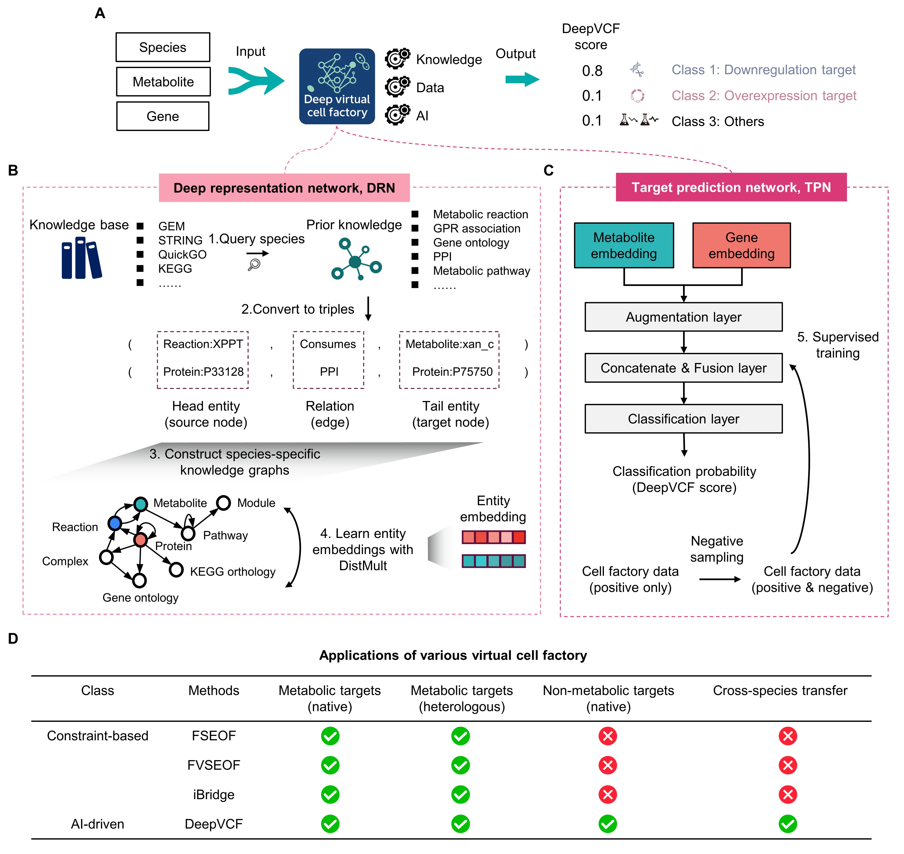

# AI virtual cell factory for enhanced and genome-wide target prediction

DeepVCF is the framework described in *AI virtual cell factory for enhanced and genome-wide target prediction*. It combines a biological knowledge graph (KG) with cell-factory (CF) data to rank GEM-covered and GEM-uncovered gene targets. The deep representation network (DRN) learns from the KG, and the target prediction network (TPN) uses those representations to score gene–intervention–metabolite triples.

### Gene coverage definitions

**GEM-covered genes** are represented in the genome-scale metabolic model (GEM) and can be evaluated as candidate targets by conventional constraint-based methods.

**GEM-uncovered genes** are absent from the GEM and fall outside the prediction scope of conventional constraint-based methods that rely on that model. These genes, predominantly non-metabolic with a small subset of metabolic genes, may play important roles in cell factory performance and represent a largely unexplored resource for strain engineering.



[Open Figure 1 at full resolution](./figure/figure_1.jpg)

## Repository layout

| Path | Contents |
| --- | --- |
| [`tutorial.ipynb`](tutorial.ipynb) | A walkthrough of model training, external evaluation, and prediction for one metabolite |
| [`code/`](code/) | Model, networks, data processing, training, and metrics |
| [`data/raw/`](data/raw/) | Shared references and species-specific inputs |
| [`data/processed/`](data/processed/) | Prepared KGs, CF training and evaluation splits, and case-study tables |
| [`data/scripts/`](data/scripts/) | KG construction and CF dataset preparation |
| [`baselines/`](baselines/README.md) | FSEOF, FVSEOF, and iBridge prediction tables |
| [`reproducibility/`](reproducibility/) | Training and evaluation entry points |
| [`figure/`](figure/) | Plotting scripts and existing figure outputs, grouped by analysis |

The datasets cover five species, identified in filenames and commands as ECO, CGL, SCE, BSU, and PPU. See the [data guide](data/README.md) for file formats and directory details.

When preparing your own inputs, use the files in [`data/processed/`](data/processed/) as format examples. For training, see the [ECO knowledge graph](data/processed/kg/ECO/kg_enhanced.txt) and the [labeled CF training data](data/processed/cf/train/train.txt).

If you are new to the codebase, you can use a coding agent to help set up the environment, run the tutorial, reproduce the benchmarks, or use DeepVCF for predictions. Share this repository with the agent and point it to the [tutorial](tutorial.ipynb) and [reproducibility guide](reproducibility/README.md).

## Environment

Run the commands below from the repository root. For an existing environment, use `conda activate deepvcf`. The local environment uses Python 3.9, PyTorch 2.8.0 with CUDA 12.6, and PyTorch Geometric 2.6.1. The following setup uses that combination. Choose a PyTorch build compatible with your driver and hardware if your setup differs.

```bash
conda create -n deepvcf python=3.9 -y
conda activate deepvcf
python -m pip install torch==2.8.0 --index-url https://download.pytorch.org/whl/cu126
python -m pip install torch-geometric==2.6.1 numpy pandas scipy scikit-learn matplotlib tqdm
```

For the tutorial, install JupyterLab and its Python kernel. Open `tutorial.ipynb` with the `deepvcf` environment selected. The notebook uses `cuda:0` by default.

```bash
python -m pip install jupyterlab ipykernel
jupyter lab tutorial.ipynb
```

Plotting scripts may require additional packages such as `networkx`, `powerlaw`, and `umap-learn`.

## Training

This example trains the DRN and TPN on the prepared ECO datasets. Add `--dry-run` to inspect the run configuration before training. The default device is `cuda:0`.

```bash
python reproducibility/training/train_deepvcf.py \
  --species ECO \
  --kg ECO=data/processed/kg/ECO/kg_enhanced.txt \
  --train-path data/processed/cf/train/train.txt \
  --output-dir results/training/ECO \
  --seeds 1
```

The final model is saved to `results/training/ECO/seed_1/model.pt`. The [training guide](reproducibility/training/README.md) covers DRN and TPN training as separate steps, checkpoint reuse, and the mechanistic pretraining modes.

## Reference performance

The table summarizes the ECO external benchmark for GEM-covered and GEM-uncovered genes. Values are the mean ± sample standard deviation across five seeds. Hits@K uses filtered gene rankings. MP denotes mechanistic pretraining.

DeepVCF results come from the current implementation. ML and mechanistic baseline results come from archived evaluations using the same CF training, external test, and ranking-filter files. See [Baseline reference results in the tutorial](tutorial.ipynb#Baseline-reference-results).

| Gene group | Method | AUROC | AUPR | Hits@10 | Hits@20 | Hits@30 |
| --- | --- | ---: | ---: | ---: | ---: | ---: |
| GEM-covered | DeepVCF+MP | 0.8824 ± 0.0022 | 0.7574 ± 0.0077 | 0.2873 ± 0.0266 | 0.3739 ± 0.0253 | 0.4459 ± 0.0211 |
| GEM-covered | DeepVCF | 0.8517 ± 0.0094 | 0.6916 ± 0.0135 | 0.2261 ± 0.0205 | 0.3134 ± 0.0129 | 0.3834 ± 0.0230 |
| GEM-covered | LR (DRN) | 0.7310 ± 0.0149 | 0.4784 ± 0.0224 | 0.0389 ± 0.0194 | 0.0879 ± 0.0217 | 0.1554 ± 0.0298 |
| GEM-covered | MLP (DRN) | 0.7617 ± 0.0173 | 0.5624 ± 0.0418 | 0.0866 ± 0.0176 | 0.1478 ± 0.0210 | 0.2013 ± 0.0242 |
| GEM-covered | RF (DRN) | 0.7275 ± 0.0124 | 0.5014 ± 0.0176 | 0.0796 ± 0.0087 | 0.1382 ± 0.0094 | 0.1834 ± 0.0140 |
| GEM-covered | LR (random) | 0.6314 ± 0.0149 | 0.4001 ± 0.0143 | 0.0185 ± 0.0145 | 0.0529 ± 0.0217 | 0.0994 ± 0.0271 |
| GEM-covered | MLP (random) | 0.6921 ± 0.0090 | 0.4686 ± 0.0073 | 0.0771 ± 0.0141 | 0.1408 ± 0.0143 | 0.1911 ± 0.0179 |
| GEM-covered | RF (random) | 0.6353 ± 0.0031 | 0.4162 ± 0.0067 | 0.0739 ± 0.0104 | 0.1299 ± 0.0104 | 0.1631 ± 0.0140 |
| GEM-covered | FSEOF | 0.5758 ± 0.0185 | 0.4064 ± 0.0127 | 0.1287 ± 0.0017 | 0.1573 ± 0.0036 | 0.1656 ± 0.0023 |
| GEM-covered | FVSEOF | 0.6753 ± 0.0100 | 0.4455 ± 0.0033 | 0.1153 ± 0.0014 | 0.1771 ± 0.0017 | 0.2076 ± 0.0042 |
| GEM-covered | iBridge | 0.5772 ± 0.0092 | 0.3728 ± 0.0058 | 0.0166 ± 0.0014 | 0.0465 ± 0.0017 | 0.0898 ± 0.0027 |
| GEM-uncovered | DeepVCF+MP | 0.7453 ± 0.0139 | 0.6199 ± 0.0139 | 0.1900 ± 0.0224 | 0.2550 ± 0.0326 | 0.2900 ± 0.0137 |
| GEM-uncovered | DeepVCF | 0.7285 ± 0.0197 | 0.6242 ± 0.0305 | 0.2000 ± 0.0250 | 0.2250 ± 0.0177 | 0.2600 ± 0.0224 |
| GEM-uncovered | LR (DRN) | 0.6981 ± 0.0282 | 0.3949 ± 0.0172 | 0.0000 ± 0.0000 | 0.0100 ± 0.0224 | 0.0100 ± 0.0224 |
| GEM-uncovered | MLP (DRN) | 0.7296 ± 0.0378 | 0.5172 ± 0.0668 | 0.1100 ± 0.0418 | 0.1850 ± 0.0487 | 0.2200 ± 0.0447 |
| GEM-uncovered | RF (DRN) | 0.6724 ± 0.0408 | 0.4904 ± 0.0657 | 0.1550 ± 0.0671 | 0.1650 ± 0.0602 | 0.1750 ± 0.0586 |
| GEM-uncovered | LR (random) | 0.5820 ± 0.0358 | 0.3327 ± 0.0524 | 0.0050 ± 0.0112 | 0.0150 ± 0.0224 | 0.0250 ± 0.0250 |
| GEM-uncovered | MLP (random) | 0.6339 ± 0.0414 | 0.4069 ± 0.1002 | 0.0550 ± 0.0411 | 0.0900 ± 0.0454 | 0.1100 ± 0.0285 |
| GEM-uncovered | RF (random) | 0.6118 ± 0.0470 | 0.4103 ± 0.0476 | 0.0850 ± 0.0285 | 0.0900 ± 0.0379 | 0.1100 ± 0.0285 |

## Reproducing evaluations and figures

| Analysis | Entry point |
| --- | --- |
| Internal holdouts and ablations | [`reproducibility/internal_evaluation/evaluate_deepvcf.py`](reproducibility/internal_evaluation/evaluate_deepvcf.py) |
| External benchmarks | [`reproducibility/external_evaluation/`](reproducibility/external_evaluation/) |
| Cross-species transfer | [`reproducibility/cross_species_transfer/evaluate_deepvcf.py`](reproducibility/cross_species_transfer/evaluate_deepvcf.py) |
| Heterologous target prediction | [`reproducibility/heterologous_target_prediction/`](reproducibility/heterologous_target_prediction/) |

Use `--help` on each evaluation script for its inputs and options. To preview the external benchmark for DeepVCF with mechanistic pretraining, run the command below. Remove `--dry-run` to train and evaluate the model.

```bash
python reproducibility/external_evaluation/evaluate_deepvcf.py --modes mp --seeds 1 --dry-run
```

The internal evaluation loads a DRN checkpoint for each selected variant and seed. Generate the required checkpoints with [`train_drn.py`](reproducibility/training/train_drn.py) or supply an existing checkpoint with `--checkpoint` for a single variant.

Training and evaluation scripts write checkpoints and metrics under `results/` by default or to the output path you supply. This checkout includes prepared data and existing plots in `figure/`. To regenerate plots that read from `results/`, run the corresponding training and evaluation jobs first.

## Acknowledgments

We thank the developers of FSEOF, FVSEOF, and iBridge, whose methods provided the mechanistic baselines for this study. We also thank the D2Cell team for compiling the cell-factory data used in this work.

## Contact

nsk25@mails.tsinghua.edu.cn
